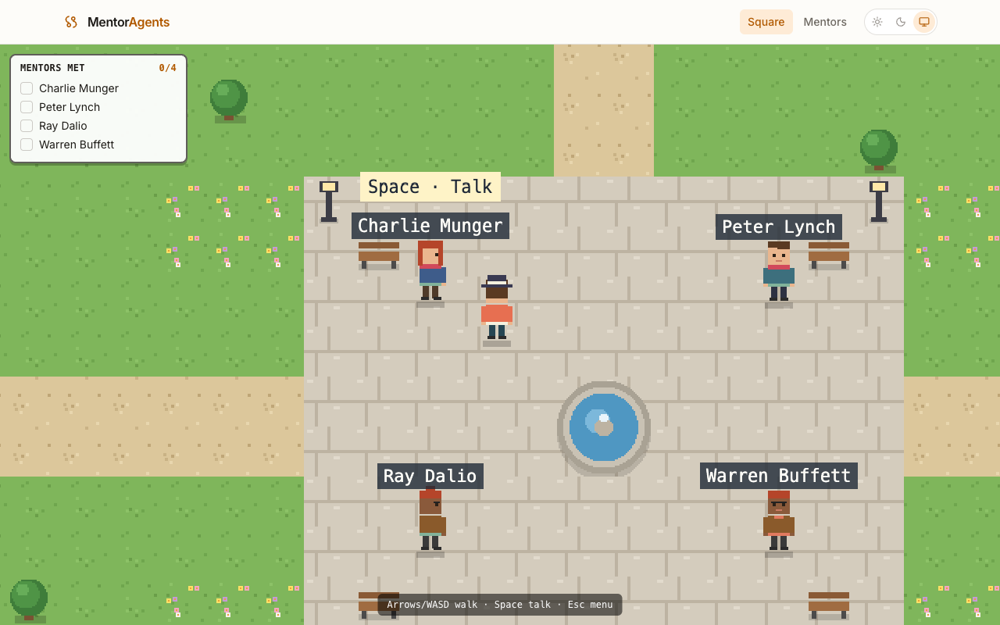

<div align="center">

# MentorAgents

**Where human expertise meets AI.**

Chat with AI mentors modelled on real experts. Each mentor answers from a
long-term memory built out of that person's own public work.

[](https://github.com/ananthanarayanan431/mentoragent/actions/workflows/ci.yml)
[](LICENSE)
[](.python-version)
[](web/package.json)

</div>

---

A mentor is a name, an area of expertise, a perspective and a speaking style.
Behind each one sits a retrieval-augmented agent: the person's PDFs, Wikipedia
pages, YouTube transcripts and tweets are extracted, de-duplicated, embedded and
stored in MongoDB Atlas, then retrieved as context when you ask a question.
Replies stream back token by token.

The web app opens on **Mentor Square**, a small pixel-art town where the mentors
wander around. Walk up to one (arrow keys, WASD, or tap) and press Space to talk;
the reply streams into a dialogue box. A quest log tracks who you've met. Prefer a
plain chat? The classic list and chat pages are one click away.



| Service      | Where                         | Port  | Docs                                                             |
| ------------ | ----------------------------- | ----- | ---------------------------------------------------------------- |
| Mentor agent | `agents/mentor_agent`         | 8000  | [`agents/mentor_agent/CLAUDE.md`](agents/mentor_agent/CLAUDE.md) |
| Web app      | `web/`                        | 5173  | [`web/CLAUDE.md`](web/CLAUDE.md)                                 |
| API contract | `libs/mentor-agent-contracts` |       | [`libs/README.md`](libs/README.md)                               |
| MongoDB      | `infra/`                      | 27017 | [`infra/docker-compose.yml`](infra/docker-compose.yml)           |

```text
  Browser ──▶ web/ (React 19, Vite; nginx in Docker)
                │  REST + WebSocket, /api proxied to the agent
                ▼
              agents/mentor_agent/ (FastAPI, LangGraph agent, RAG)
                │
                ▼
              MongoDB Atlas Local (documents, vector index, checkpoints)

  Ingestion:  PDFs · Wikipedia · YouTube · X ──▶ split ──▶ embed ──▶ Atlas
```

## Run it

Prerequisites: Docker with the Compose plugin, [uv](https://docs.astral.sh/uv/),
and Node (see `.nvmrc`) with pnpm 10.

```bash
cp infra/.env.example infra/.env                            # MongoDB credentials
make -C infra up                                            # MongoDB, waits until healthy
make -C agents/mentor_agent env                             # then fill in OPENROUTER_API_KEY
make -C agents/mentor_agent seed                            # first run only: mentors + long-term memory
agents/mentor_agent/run.sh                                  # API on :8000 (docs at /docs)
pnpm install && pnpm dev                                    # web app on :5173
```

The web dev server proxies `/api` (WebSocket included) to the agent, so there is
no CORS setup. To run everything in containers instead:
`make -C infra stack-up`, then open <http://localhost:8080>.

`OPENROUTER_API_KEY` is the only required key: chat and embeddings both go through
OpenRouter. Arcade (tweets), LangSmith and Comet/Opik (tracing, evaluation) are
optional; `agents/mentor_agent/.env.example` documents every variable.

## Repository layout

```text
mentoragent/
├── agents/mentor_agent/   # FastAPI service, LangGraph agent, RAG pipeline (package mentor_agent)
├── web/                   # React app (pnpm workspace package @mentoragent/web)
├── libs/                  # shared TypeScript packages: the agent's API contract
├── infra/                 # compose files (MongoDB, agent, web) and their Makefile
├── scripts/ci/            # python-checks.sh: the Python gate CI runs
├── pyproject.toml         # Ruff, Pyright and pytest rules for every Python package
├── package.json           # pnpm workspace root: format, lint, typecheck, test, build
├── .githooks/             # commit-msg and pre-commit hooks
└── .github/               # CI, PR labels, CODEOWNERS, Dependabot
```

## Development

```bash
scripts/ci/python-checks.sh agents/mentor_agent all   # ruff, pyright strict, pytest + coverage, pip-audit
pnpm check                                            # prettier, oxlint, tsc, vitest, build
make -C agents/mentor_agent openapi                   # after an API change: refresh the web contract
```

CI runs exactly these. See [CONTRIBUTING.md](CONTRIBUTING.md) for setup, the
conventions each part follows, and the commit rules.

## License

[MIT](LICENSE).

Mentor replies are generated by a language model drawing on published material.
They are not the words of the people the mentors are modelled on, and should
not be presented as such.
